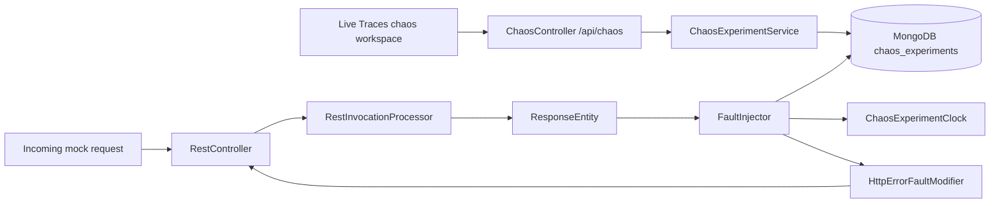
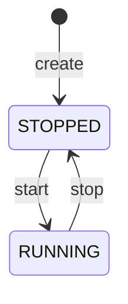

# Microcks Chaos Testing — Current Architecture

**Status:** Implemented first increment
**Scope:** `HTTP_ERROR` and `LATENCY` modifiers
**Audience:** Microcks backend and frontend contributors

This document describes the architecture currently implemented in the repository. It intentionally describes the code as it exists today, not the longer-term design proposal in `Microcks_Chaos_Testing_Technical_Specification_v0.3.md`.

---

## 1. Goals of the current increment

The current implementation supports one use case:

> During a bounded time window, return a synthetic HTTP error for a given mocked service/operation, based on a keyframed probability curve.

It provides:

- Persisted risk-free experiment definitions
- A two-state lifecycle: `RUNNING`, `STOPPED`
- Step-based keyframe evaluation
- Per-request probability sampling
- Synthetic HTTP error responses
- Artificial response delays (latency)
- A management REST API
- An Angular editor and experiment console

It deliberately does **not** provide:

- Caching or compiled timelines
- A scheduler or background experiment engine
- Corruption, truncation, disconnect or HTTP/2 faults
- Preview or event-history endpoints
- GitOps scenario import
- Multi-replica cache propagation
- OpenTelemetry or Micrometer chaos metrics

---

## 2. High-level flow



Unlike an optimized design with a local snapshot cache, the current implementation reads active experiments from MongoDB for every mock request. Caching is intentionally deferred.

---

## 3. Code layout

### Backend

```text
commons/model/src/main/java/io/github/microcks/
└── domain/chaos/
    ├── ChaosExperiment.java            # definition document (timeline only)
    ├── ExperimentRun.java              # run document (state + clock anchors)
    ├── ExperimentState.java
    ├── InvalidExperimentException.java
    ├── ModifierTrack.java
    ├── ModifierConfig.java
    ├── HttpErrorModifierConfig.java
    ├── LatencyModifierConfig.java
    ├── ModifierType.java
    ├── ParameterCurve.java
    └── Keyframe.java

webapp/src/main/java/io/github/microcks/
├── chaos/                              # request-time engine only
│   ├── FaultInjector.java
│   ├── ChaosExperimentClock.java
│   ├── ChaosConfiguration.java         # Clock bean shared by the whole feature
│   ├── ChaosModifierDescriptor.java
│   ├── ChaosModifierParam.java
│   └── modifier/
│       ├── FaultModifier.java
│       ├── HttpErrorFaultModifier.java
│       └── LatencyFaultModifier.java
├── repository/
│   ├── ChaosExperimentRepository.java
│   └── ChaosExperimentRunRepository.java
├── service/
│   └── ChaosExperimentService.java     # control plane (lifecycle, validation, persistence)
└── web/
    ├── ChaosController.java
    └── dto/
        └── ChaosExperimentDTO.java     # flat API representation served to editors
```

The chaos domain lives in `commons/model` like the rest of `io.github.microcks.domain`: the module already carries the
Spring Data MongoDB and Jackson dependencies, so there is no split package across artifacts. The `webapp` module keeps
a single `chaos` package for the request-time engine only; the management controller lives in `web/`, the control-plane
service in `service/` and the API representation in `web/dto/`, matching the horizontal layering used everywhere else
in the codebase. Dependencies flow one way: `web → service → domain` and `web → chaos → domain`.

### Frontend

```text
webapp/src/main/webapp/src/app/
├── models/
│   ├── chaos.model.ts
│   └── chaos-modifiers.ts
├── services/
│   └── chaos.service.ts
├── components/chaos/
│   ├── chaos-editor.component.ts / .html / .css
│   ├── chaos-editor.service.ts
│   ├── chaos-editor.utils.ts / .spec.ts
│   ├── chaos-effect-controls.component.ts / .html / .css
│   ├── chaos-target-graph.component.ts / .html / .css
│   ├── chaos-target-node.component.ts
│   ├── chaos-timeline.component.ts / .html / .css
└── pages/chaos/
    ├── chaos.page.ts / .html / .css
```

---

## 4. Domain model

### 4.1 `ChaosExperiment` and `ExperimentRun`

The definition and the current run are two documents, so a definition can be edited or reused without carrying run
state along.

`ChaosExperiment` (collection `chaos_experiments`) holds only the reusable timeline:

```java
@Document(collection = "chaos_experiments")
public class ChaosExperiment {
   @Id
   private String id;
   @Indexed
   private String name;
   private String description;
   private long durationMs;
   private List<ModifierTrack> tracks = new ArrayList<>();
}
```

`ExperimentRun` (collection `chaos_experiment_runs`) holds the state and the clock anchors of the current run. There is
at most one run per experiment; an experiment without a run never started:

```java
@Document(collection = "chaos_experiment_runs")
public class ExperimentRun {
   @Id
   private String id;
   @Indexed
   private String experimentId;
   private ExperimentState state = ExperimentState.STOPPED;
   private long anchorPositionMs;
   private Instant anchorWallTime;
}
```

Example persisted shapes:

```json
// chaos_experiments
{
  "id": "665f...",
  "name": "payment-resilience",
  "description": "Inject transient payment errors",
  "durationMs": 120000,
  "tracks": [
    {
      "id": "payment-error",
      "serviceName": "Payment Service",
      "operationName": "POST /payments",
      "startMs": 0,
      "endMs": 120000,
      "probability": {
        "keyframes": [
          { "timeMs": 0, "value": 0.0 },
          { "timeMs": 20000, "value": 0.7 },
          { "timeMs": 90000, "value": 0.0 }
        ]
      },
      "modifier": {
        "type": "HTTP_ERROR",
        "statusCode": { "keyframes": [{ "timeMs": 0, "value": 503 }] },
        "responseBody": "{\"error\":\"payment unavailable\"}"
      }
    }
  ]
}

// chaos_experiment_runs
{
  "id": "665g...",
  "experimentId": "665f...",
  "state": "RUNNING",
  "anchorPositionMs": 0,
  "anchorWallTime": "2026-10-25T15:00:00Z"
}
```

The management API composes both back into the flat `ChaosExperimentDTO` (`web/dto`), which adds the derived
`currentPositionMs`. Create and update bind directly to the definition: the run state is never part of a request body.

### 4.2 `ModifierTrack`

A track binds a service/operation target, an active window, an occurrence probability and a modifier configuration.

```java
public class ModifierTrack {
   private String id;
   private String serviceName;
   private String operationName;
   private long startMs;
   private long endMs;
   private ParameterCurve probability;
   private ModifierConfig modifier;
}
```

Important properties:

- Tracks have no priority.
- Tracks are evaluated and applied in list order.
- There is no separate `enabled` flag: probability `0` means inactive.
- Service targeting uses `serviceName` + `operationName`, matching the Live Traces naming approach.
- `ModifierTrack.validate()` is pure: a missing `endMs` (zero or less) is rejected. The service resolves it to the
  experiment duration before persisting, so stored tracks always carry an explicit window.

### 4.3 `ParameterCurve` and `Keyframe`

```java
public class ParameterCurve {
   private List<Keyframe> keyframes;
}

public class Keyframe {
   private long timeMs;
   private double value;
}
```

Only step interpolation exists:

```text
valueAt(t) = value of the latest keyframe whose timeMs <= t
```

Behavior:

- Before the first keyframe: use the first keyframe value.
- Between keyframes: use the previous keyframe value.
- At a keyframe timestamp: use that keyframe value.
- After the last keyframe: keep the last keyframe value.
- Empty curve: returns `0`.

There is no `LINEAR`, `SMOOTHSTEP`, text keyframe or interpolation configuration.

### 4.4 Persisted/runtime separation

```text
Persistence                         Runtime
-----------                         -------
ModifierConfig                      FaultModifier
    ▲                                   ▲
    │                                   │
HttpErrorModifierConfig               HttpErrorFaultModifier
(statusCode, responseBody)     (inject into ResponseEntity)
```

`ModifierConfig` is polymorphic for MongoDB persistence:

```java
@JsonTypeInfo(
    use = JsonTypeInfo.Id.NAME,
    include = JsonTypeInfo.As.EXISTING_PROPERTY,
    property = "type")
@JsonSubTypes({
    @JsonSubTypes.Type(value = HttpErrorModifierConfig.class, name = "HTTP_ERROR")
})
public interface ModifierConfig {
   ModifierType getType();
}
```

`HttpErrorModifierConfig` contains only persisted data:

- `ParameterCurve statusCode` (keyframed with step semantics; the descriptor advertises it as keyframeable)
- `String responseBody`

Its constants (`MIN_STATUS_CODE`, `MAX_STATUS_CODE`, `DEFAULT_STATUS_CODE`, `DEFAULT_LATENCY_MS`) are the single
source shared by `validate()` and the descriptor served to editors. It has no Spring Web dependency, no
`ResponseEntity`, and no injection logic.

`HttpErrorFaultModifier` is the Spring runtime implementation:

```java
@Component
public class HttpErrorFaultModifier implements FaultModifier {
   type()        -> HTTP_ERROR
   descriptor()  -> required catalog entry served to editors, built from the config constants
   inject(...)   -> evaluates statusCodeAt(positionMs), copies the generated response headers
                    (CORS, content type, mock-defined headers), adjusts Content-Length and
                    returns a synthetic ResponseEntity
}
```

The runtime contract receives the persisted config, not the whole track:

```java
ResponseEntity<byte[]> inject(
    ModifierConfig modifier,
    long positionMs,
    ResponseEntity<byte[]> response);
```

### 4.5 `ExperimentState`

```java
public enum ExperimentState {
   RUNNING,
   STOPPED
}
```

The state belongs to `ExperimentRun`. New experiments have no run until they are started for the first time and report
as `STOPPED`.

---

## 5. Lifecycle and clock

`ChaosExperimentService` owns all control-plane transitions.



### Clock semantics

`ChaosExperimentClock` computes the logical position from persisted anchors:

```text
RUNNING:
    position = (anchorPositionMs + (now - anchorWallTime)) % durationMs

STOPPED:
    position = anchorPositionMs
```

Then clamps:

```text
position = max(0, min(durationMs, position))
```

There is no background timer and no counter stored in MongoDB. A running experiment loops over its
duration: the playhead wraps back to `0` at each cycle end and keeps going until the experiment is stopped.

Lifecycle anchor updates (on the run document):

| Action | Run state | Anchor position | Anchor wall time |
| --- | --- | --- | --- |
| Create | no run yet | – | – |
| Start | `RUNNING` | `0` | now |
| Stop | `STOPPED` | current position | `null` |

`currentPositionMs` is computed when experiments are read from the API and is carried by `ChaosExperimentDTO`, not by
the persisted documents.

### Expiration

There is no `COMPLETED` state and no expiration: a running experiment loops over its duration until it is stopped.

---

## 6. Request-time fault injection

### 6.1 Controller integration

`RestController` first generates the normal mock response, then calls the injector:

```java
ResponseResult response = invocationProcessor.processInvocation(...);

ResponseEntity<byte[]> generated =
    new ResponseEntity<>(response.content(), response.headers(), response.status());

String serviceName = ic.service() != null ? ic.service().getName() : null;
String operationName = ic.operation() != null ? ic.operation().getName() : null;

return faultInjector.inject(serviceName, operationName, generated);
```

Consequences:

- Normal dispatch, callbacks and AsyncAPI triggers run before the fault is applied.
- `HTTP_ERROR` replaces the generated response with the synthetic one.
- No pre-dispatch shortcut currently exists.

### 6.2 `FaultInjector`

`FaultInjector` does not depend on `HttpServletRequest` or `MockInvocationContext`.

```java
public ResponseEntity<byte[]> inject(
    String serviceName,
    String operationName,
    ResponseEntity<byte[]> response)
```

Algorithm:

```text
result = generated response

runs = MongoDB.runs.findByStateIn(RUNNING)
definitions = MongoDB.experiments.findAllById(runs.experimentIds)

for each (definition, run) pair:
    position = clock.positionAt(run, definition.durationMs)

    for each track in definition.tracks (list order):
        if track.serviceName != request.serviceName: continue
        if track.operationName != request.operationName: continue

        probability = track.probabilityAt(position)
        if probability <= 0: continue
        if probability < 1 and ThreadLocalRandom.current().nextDouble() >= probability: continue

        runtimeModifier = modifiers[track.modifier.type]
        if runtimeModifier exists:
            result = runtimeModifier.inject(track.modifier, position, result)
            result = telemetry.onInjection(..., result)

return result
```

Key properties:

- Matching is case-insensitive on service name and operation name.
- Two MongoDB queries per mock request (runs by state, then definitions by id) until the caching optimization lands.
- Probability is sampled once per matching track per request with `ThreadLocalRandom` (the shared
  `RandomGenerator.getDefault()` is not thread-safe).
- Modifiers are executed in track order.
- With multiple selected `HTTP_ERROR` tracks, the last one wins because each returns a new synthetic response.

Every applied injection runs in a dedicated `chaosFaultInjection` INTERNAL child span of the mock invocation span,
created directly in `FaultInjector` with the `OpenTelemetryResolverService` tracer (the same pattern as
`RestInvocationProcessor.computeDispatchCriteria`). The span carries the `chaos.*` attributes from
`CommonAttributes` (`chaos.experiment.id`, `chaos.experiment.name`, `chaos.track.id`, `chaos.fault.type`,
`chaos.position.ms`, `chaos.probability`) and is marked for explain tracing, so injected faults are visible and
correlated in Live Traces. `FaultInjector` also logs each injection.

### 6.3 Runtime modifier registry

`FaultInjector` builds an `EnumMap<ModifierType, FaultModifier>` from all Spring `FaultModifier` beans.

```java
FaultModifier modifier = modifiers.get(track.getModifier().getType());
```

This keeps persisted configuration independent from runtime execution.

### 6.4 HTTP error injection

`HttpErrorFaultModifier`:

1. Casts the persisted config to `HttpErrorModifierConfig`.
2. Evaluates the keyframed `statusCode` at the current position (`statusCodeAt`, step semantics).
3. Reads `responseBody`.
4. Copies the generated response headers (CORS policy, content type, mock-defined headers), adjusts
   `Content-Length` to the synthetic body and returns a new `ResponseEntity`. Headers are preserved so browser
   clients keep working CORS behavior on injected errors.

The incoming response is accepted by the signature so future modifiers can mutate or decorate it. HTTP_ERROR currently replaces it.

### 6.5 Latency injection

`LatencyFaultModifier`:

1. Casts the persisted config to `LatencyModifierConfig`.
2. Blocks the request thread for the latency evaluated at the current position (keyframed, validated between
   `0` and `60s`).
3. Returns the incoming response unchanged.

Because the response is untouched, latency composes with the modifiers that follow it in track order: a latency
track placed before an HTTP error track delays the synthetic error itself. Multiple matching latency tracks
add up.

---

## 7. Validation

Validation is owned by the domain objects and invoked before create and update persistence:

```java
experiment.validate();
```

It is pure: no field is rewritten during validation. Input normalization happens in `ChaosExperimentService` before
validation, and every rejection throws `InvalidExperimentException` (a subclass of `IllegalArgumentException` defined
in `io.github.microcks.domain.chaos`).

`ChaosExperimentService` normalizes before validating:

- A track window without an explicit end (`endMs <= 0`) is resolved to the experiment duration, so stored tracks
  always carry an explicit window.

`ChaosExperiment.validate()` handles aggregate rules:

- Experiment duration must be between `1` and `24h`.
- Delegates each track to `ModifierTrack.validate(durationMs)`.
- Track IDs must then be unique (the non-blank id rule lives in `ModifierTrack.validate` only).

`ModifierTrack.validate(durationMs)` handles track rules:

- `id` must be non-blank (single place; the aggregate relies on it for duplicate detection).
- `serviceName` and `operationName` are required.
- The window must satisfy `0 < startMs < endMs <= durationMs`.
- Probability curve must be valid.
- Probability values must be in `[0,1]`.
- Delegates to `modifier.validate(durationMs)`.

`ModifierConfig.validate(durationMs)` is the per-modifier hook. `HttpErrorModifierConfig` validates its own inputs:

- Every `statusCode` keyframe value is between `MIN_STATUS_CODE` (`400`) and `MAX_STATUS_CODE` (`599`).

`LatencyModifierConfig` validates that latency keyframe values stay within `0` and `MAX_LATENCY_MS` (`60s`).

Database-dependent rules such as experiment-name uniqueness remain in `ChaosExperimentService`, because they cannot be decided by a single entity instance.

Invalid input becomes an HTTP `400` via the `ChaosController` handler for `InvalidExperimentException`; unrelated
`IllegalArgumentException` instances from bugs are no longer converted into client errors.

---

## 8. Management API

Base path: `/api/chaos`

| Method | Path | Purpose |
| --- | --- | --- |
| `POST` | `/experiments` | Create a `STOPPED` experiment |
| `GET` | `/experiments` | List experiments, optional `?state=` |
| `GET` | `/experiments/{id}` | Get an experiment |
| `PUT` | `/experiments/{id}` | Replace an experiment definition |
| `POST` | `/experiments/{id}/start` | Start or restart |
| `POST` | `/experiments/{id}/stop` | Stop an experiment |
| `GET` | `/modifiers` | Describe available runtime modifiers |

No preview, events, scenarios or revision endpoints exist.

### Error handling

| Exception | HTTP status |
| --- | --- |
| `ExperimentNotFoundException` | `404` |
| `InvalidExperimentException` | `400` |

Request and response are distinct contracts: create and update bind to the `ChaosExperiment` definition (run state
fields no longer exist on it), and every response is the flat `ChaosExperimentDTO` composed by the controller from the
definition, its run and the derived position.

### Security

`SecurityConfiguration` protects `/api/chaos/**`:

- `GET` requires `user`, `manager` or `admin`.
- Other methods require `manager` or `admin`.

Mock routes remain public, matching existing REST mock behavior.

---

## 9. Frontend architecture

### Integration into Live Traces

Chaos is embedded directly in the `/traces` page:

```text
Live Traces page
├── trace graph (main area)
└── chaos workspace (right)
    ├── effect controls panel
    └── interactive dope sheet timeline
```

There is no separate `/chaos` route or navigation item.

### Components

- `ChaosSidePanelComponent` — After Effects-style Effect Controls panel: experiment selection, lifecycle controls, modifier list, live value preview and detailed editing
- `ChaosDopeSheetComponent` — interactive video-style timeline inside the right panel: ruler, draggable playhead, draggable probability keyframes, double-click keyframe creation
- `ChaosWorkspaceService` — shared experiment state and polling between the panel and timeline

### Services and models

`ChaosService` calls the management API:

- list/get/create/update
- start/stop
- list modifiers

`ChaosWorkspaceService` holds:

- experiments list
- selected experiment
- services list
- polling while the selected experiment is running

`chaos.model.ts` mirrors the backend shape:

```ts
ChaosExperiment
  ├── id, name, description, durationMs
  ├── state, anchorPositionMs, anchorWallTime
  ├── currentPositionMs
  └── tracks: ChaosTrack[]

ChaosTrack
  ├── id
  ├── serviceName, operationName
  ├── probability: ChaosCurve
  └── modifier: HttpErrorModifierConfig

HttpErrorModifierConfig
  ├── type: HTTP_ERROR
  ├── statusCode: number
  └── responseBody: string
```

### Workspace capabilities

- Select an experiment from the Effect Controls panel.
- Create/edit experiments and modifier tracks.
- Select target service and operation.
- Edit step probability keyframes numerically or by dragging them on the timeline.
- Set the static HTTP status code and response body.
- Drag the timeline playhead to preview values at another time.
- Toggle a live preview of probability, HTTP status and response body.
- Double-click a timeline lane to add a probability keyframe at that position.
- Start and stop experiments.
- Poll the selected experiment while running.

The workspace does not include preview or event history.

---

## 10. Extension path for a new modifier

To add a new fault type:

1. Add an enum value to `ModifierType`.
2. Add a persisted config class implementing `ModifierConfig`.
3. Register the config in `ModifierConfig`'s `@JsonSubTypes`.
4. Add a runtime class implementing `FaultModifier` with its required `descriptor()`: type, label,
   editable parameters (probability first, with bounds and defaults) and interpolation modes.
5. Annotate the runtime class with `@Component`.
6. Implement `validate(long durationMs)` on the new `ModifierConfig`.
7. Extend `FaultInjector` only if selection behavior needs to change.
8. Add frontend model, editor fields and display handling.

Because `FaultInjector` builds its registry from Spring beans and the management API simply aggregates
`descriptor()`, a new runtime modifier is automatically discovered and served to editors.

---

## 11. Known limitations and trade-offs

| Area | Current behavior |
| --- | --- |
| Persistence access | Two MongoDB queries on every mock request (runs by state, then definitions) |
| Multi-replica | No shared in-memory snapshot or propagation control |
| Execution order | Track list order; no priority |
| Multiple HTTP_ERROR tracks | Each applies in order; last response wins |
| Fault timing | Fault applied after normal mock generation |
| Side effects | Callbacks/triggers run before the synthetic error is applied |
| Expiration | No `COMPLETED` state; experiments loop until stopped |
| Interpolation | Step only |
| Modifier types | HTTP_ERROR, LATENCY |
| Preview | Not implemented |
| Events | Not implemented |
| GitOps | Not implemented |
| Caching | Not implemented |
| Concurrency | No `@Version` on the documents; last write wins |

The first optimization to consider later is replacing the per-request MongoDB query with a locally cached immutable snapshot, without changing the `FaultInjector` contract.

---

## 12. Tests

| Test class | Coverage |
| --- | --- |
| `ParameterCurveTest` (commons/model) | Step keyframe boundaries and validation |
| `ChaosTimelineTest` | Clock anchoring, validation, service/operation matching |
| `ChaosControllerIT` | HTTP_ERROR and LATENCY injection, catalog and start/stop lifecycle, window resolution and injection marker headers |
| `RestControllerIT` | Existing REST mock behavior remains intact |

Typical verification commands:

```bash
mvn compile -f webapp/pom.xml
mvn spotless:check

mvn -pl webapp -am -Dtest='ChaosControllerIT,ChaosTimelineTest,RestControllerIT,ParameterCurveTest' \
    -Dsurefire.failIfNoSpecifiedTests=false test

cd webapp/src/main/webapp
npm run build
```

Beyond the Maven tests, `testsuite/chaos-usage-test.js` is a standalone k6 harness launched separately. It is
self-sufficient and non-destructive: it imports the two mocked APIs it needs (when missing) and the chaos experiment
`k6-degradation-storm` (an existing same-named experiment is updated, stopped and restarted, never deleted), drives a
10-minute load on three mocked APIs and stops the experiment at the end. The storm is one experiment with one track
per intention: a 12-keyframe latency ramp on the pastry API (0-2.5min), graduated 429 rate limiting (2.5-5min), an
escalating 5xx outage rotating 500/502/503 (5-7.5min) then timeouts (30s latency above the 10s client timeout,
7.5-10min); two extra layers overlap the Petstore API with 429s (3-5min) and 5xx (5.5-8min) so both services degrade
at the same time. Run it with the k6 web dashboard (`K6_WEB_DASHBOARD=true`, optionally `K6_WEB_DASHBOARD_EXPORT=...`
for a standalone interactive HTML): the dashboard charts built-in metrics only, so the exported report is
post-processed by `testsuite/chaos-report-panels.py`, which injects a Chaos tab plotting the evolution of the
`storm_*` / `petstore_*` fault shares, storm latency and request rates, with `baseline_item_duration` as the clean
control. See `testsuite/README.md`.

---

## 13. Quick reference

### Why no cache?

Intentional first-PR simplification. Requests read MongoDB directly. Caching can be added behind `FaultInjector` later.

### Why no `revision`?

Not needed yet. Last write wins on `PUT`.

### Why no preview endpoint?

Editor-only preview was removed. Probability and timeline display are calculated in the Angular Live Traces workspace.

### Why no events endpoint?

Lifecycle event history was removed. It can return later as persisted events or telemetry.

### Why no `priority`?

Track list order defines execution order.

### Why a separate `ModifierConfig` and `FaultModifier`?

- `ModifierConfig` is persisted data and Jackson polymorphic metadata.
- `FaultModifier` is runtime behavior and may depend on Spring Web.

Keeping them separate prevents persistence from depending on HTTP response handling.

### Why are definition and run separate documents?

`ChaosExperiment` holds the reusable timeline; `ExperimentRun` holds the state and clock anchors of the current run.
This keeps the run lifecycle out of the definition, keeps run state out of request bodies (create/update bind to the
definition only) and lets the API return a composed `ChaosExperimentDTO` instead of a persistence entity. Run history
(one document per past run) can later be added by turning the current one-run-per-experiment upsert into inserts.

### Why a single `Clock` bean?

`ChaosConfiguration` exposes one `Clock`. `ChaosExperimentClock` (playhead) and `ChaosExperimentService` (anchor
timestamps) both inject it, so tests can freeze time consistently for the whole feature instead of managing two
independent clocks.

### Why do descriptor defaults differ from persistence defaults?

The `probability` parameter advertised to editors defaults to `0.8` (`ChaosModifierParam.DEFAULT_PROBABILITY`): it is
an editing convenience applied to newly created tracks. A persisted track without a probability curve deserializes to
`0` and stays inactive, which is the safe fallback for API clients. The difference is intentional and documented on
`ChaosModifierParam.probability()`.
