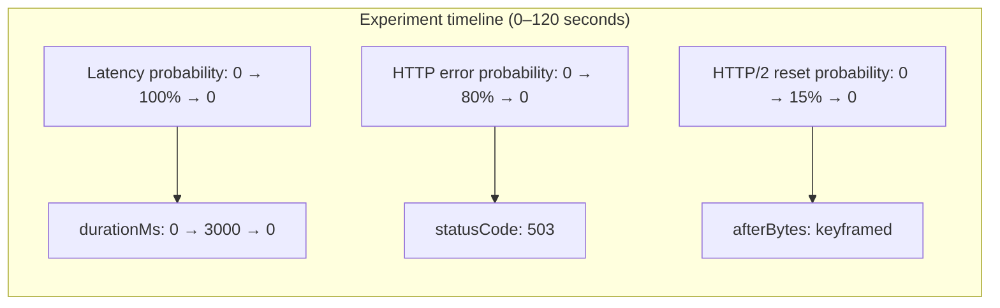
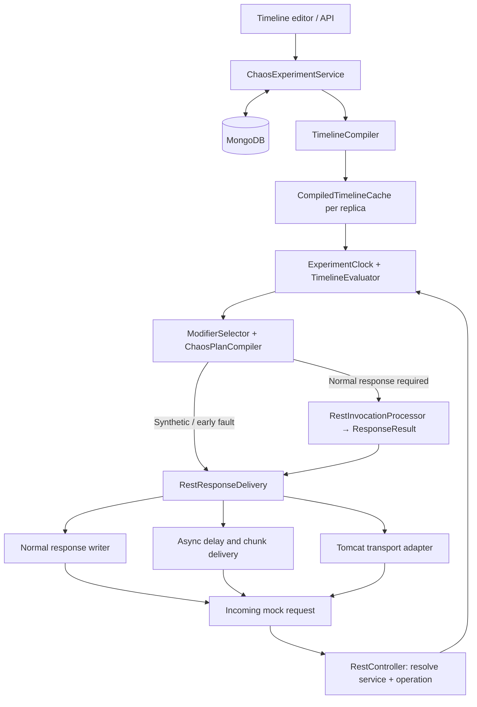
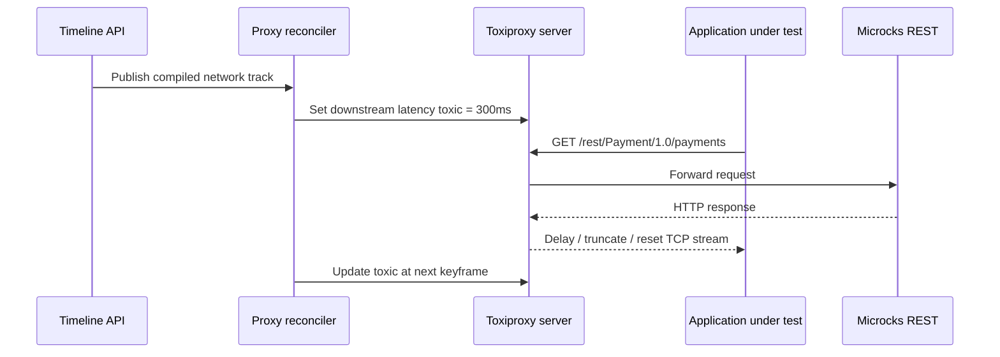

<!-- Markdown edition derived from Microcks_Chaos_Testing_Technical_Specification.docx. -->

# Microcks Chaos & Resilience Testing — Technical Specification

**Status:** Design proposal v0.3 · **Audience:** Microcks maintainers and contributors · **Reference:** [microcks/microcks#2371](https://github.com/microcks/microcks/issues/2371)

**Scope:** Keyframeable modifier probabilities and inputs, GitOps YAML scenarios, Live Traces, mock response delivery, Tomcat / GraalVM Native Image, APIs, safety, and optional Java libraries.


| Document status | Owner / audience | Reference |
| --- | --- | --- |
| Design proposal • v0.3 | Microcks maintainers, backend and frontend contributors | GitHub issue #2371 |

### Purpose

Define a maintainable backend contract for time-based chaos experiments that inject request- and response-level faults across one or more Microcks mocked services. The specification prioritizes deterministic evaluation at request time, a reusable Java fault model, safe transport handling, and compatibility with the JVM and GraalVM Native Image distributions.

### Design principle

A timeline describes desired behavior. A request evaluates that timeline once to produce a fixed plan. The response delivery layer executes the plan; it does not own experiment scheduling.




Illustrative keyframed tracks. A modifier with probability 0% is inactive; nonzero probability determines per-request selection. There is no separate modifier enabled curve.

> Scope: architecture and behavioral specification; no implementation is claimed. Version/date reflects this design discussion, not an approved Microcks release.

## Contents

- [1. Executive summary and scope](#1-executive-summary-and-scope)
- [2. Verified Microcks baseline](#2-verified-microcks-baseline)
- [3. Component architecture](#3-component-architecture)
- [4. Timeline and experiment lifecycle](#4-timeline-and-experiment-lifecycle)
- [5. Modifier tracks and keyframes](#5-modifier-tracks-and-keyframes)
- [6. Request-time evaluation and composition](#6-request-time-evaluation-and-composition)
- [7. Fault behavior specification](#7-fault-behavior-specification)
- [8. REST integration and response delivery](#8-rest-integration-and-response-delivery)
- [9. Tomcat, HTTP/2 and GraalVM Native Image](#9-tomcat-http2-and-graalvm-native-image)
- [10. API and persistence contracts](#10-api-and-persistence-contracts)
- [11. Live Traces and OpenTelemetry](#11-live-traces-and-opentelemetry)
- [12. Reliability, safety and multi-replica behavior](#12-reliability-safety-and-multi-replica-behavior)
- [13. Acceptance criteria and test matrix](#13-acceptance-criteria-and-test-matrix)
- [14. Implementation roadmap and open decisions](#14-implementation-roadmap-and-open-decisions)
- [15. Java libraries and dependency strategy](#15-java-libraries-and-dependency-strategy)
- [16. Optional Java libraries — concrete integration recipes](#16-optional-java-libraries--concrete-integration-recipes)
- [17. GitOps scenario artifacts and scheduling](#17-gitops-scenario-artifacts-and-scheduling)
- [Appendix A. Reference Java interfaces](#appendix-a-reference-java-interfaces)
- [Appendix B. Sources and repository touchpoints](#appendix-b-sources-and-repository-touchpoints)

## 1. Executive summary and scope

The proposed feature adds an experiment timeline in which each fault modifier has a keyframeable application probability and keyframed parameter inputs. No separate on/off curve is necessary. A user can model a dependency degrading gradually, failing intermittently, disconnecting, and then recovering. The same timeline can affect multiple mocked services and operations.

**Goals**

- Per-request evaluation of an experiment timeline without a database read or sleeping scheduler on the hot path.
- Keyframeable inputs (duration, probability, HTTP status, offsets, chunk size, stall time) with typed interpolation and validation.
- Eight priority REST faults: HTTP error, first-byte delay/timeout, pre-header disconnect, body corruption, truncation, slow/stalled body, mid-body abort, and HTTP/2 reset.
- Compatibility with current dispatcher/templating logic and the existing `ResponseResult(status, headers, byte[])` representation.
- Multi-pod experiment consistency, observable fault outcomes, safe bounded resource consumption, and native-image compatibility.

**Non-goals for the first increment**

- No general-purpose packet manipulation, DNS sabotage, TLS-handshake failure, or TCP connection refusal from the Spring MVC controller.
- No guarantee that an upstream HTTP/2 reset crosses an ingress proxy as an end-to-end RST_STREAM.
- No guarantees of exact global request ordering across pods (e.g., “every 3rd request”) without a shared atomic counter.
- No complete migration to WebFlux, reactive streams, or streaming response generation for existing mocks.

## 2. Verified Microcks baseline

Repository findings used to ground this proposal (master branch inspected in October 2026):

| Area | Current behavior / location |
| --- | --- |
| REST routing | RestController maps /rest/{service}/{version}/** and /rest-valid/{service}/{version}/**; resolves service/operation and optional validation. |
| Response generation | RestInvocationProcessor.processInvocation(...) returns ResponseResult; dispatching and rendering happen there. |
| Response DTO | ResponseResult is a record with HttpStatusCode, HttpHeaders and byte[] content. |
| Delay | MockControllerCommons.getDelay and waitForDelay; current processor applies delay before returning and on the proxy path. |
| Side effects | RestInvocationProcessor currently publishes callbacks and AsyncAPI triggers while processing selected responses. |
| Traces | Live Traces uses per-instance SpanStorageService memory and SSE subscriptions; not a shared control plane. |
| Build | webapp depends on Spring Boot starter web; Uber has a GraalVM native-image build profile. |
| JavaScript | Current JavaScript script binder uses QuickJS4J; transport faults should be implemented in Java, not user scripts. |

> The first PR should re-check the exact upstream versions and hook signatures, as Microcks and Spring Boot evolve.

## 3. Component architecture




Control plane persists and compiles the timeline; request plane evaluates and executes a per-request snapshot.

| Component | Responsibility |
| --- | --- |
| ChaosExperimentService | Create/edit/start/pause/resume/stop experiments; validate time ranges; enforce authorization and revision checks. |
| TimelineCompiler | Validate typed tracks; sort keyframes; index targets; produce immutable CompiledTimeline objects. |
| CompiledTimelineCache | Maintain per-replica snapshots refreshed by revision/polling; no repository calls on mock requests. |
| ExperimentClock | Resolve the current timeline position from persisted run/paused state and injected wall clock. |
| TimelineEvaluator | Purely interpolate probability/input curves at a specified timeline position. |
| ModifierSelector / PlanCompiler | Sample probabilities, validate combinations, resolve precedence, produce immutable ChaosExecutionPlan. |
| RestChaosCoordinator | Orchestrate normal mock generation versus synthetic/terminal faults; retain validation behavior. |
| RestResponseDelivery | Apply mutations, delayed headers, chunk scheduling, and complete/abort the response. |
| TransportFaultAdapter | Isolate Tomcat-specific abort implementation and HTTP/2 capability checks. |
| ChaosTelemetry | Emit selected/executed/outcome events and correlated request metrics. |

## 4. Timeline and experiment lifecycle

### 4.1 State machine and clock semantics

Lifecycle states: DRAFT → SCHEDULED → RUNNING ↔ PAUSED → COMPLETED, with STOPPED reachable from scheduled/running/paused. RUNNING/COMPLETED can be derived from timestamps; persistent state transitions are required for pause/resume and manual stop.

Persist a logical position anchor instead of incrementing a counter on a background timer. While RUNNING, positionMs = anchorPositionMs + (now − anchorWallTime). While PAUSED, positionMs = anchorPositionMs. On resume, update anchorWallTime to now and keep the position. Clamp to [0, durationMs].

On each matching request, capture the experiment clock exactly once. An in-flight request retains its chosen timeline revision and fault plan even if the user edits or stops the experiment later. The experiment end prevents new plans; in-flight work follows a separately bounded cancellation policy.

### 4.2 Scheduler responsibilities

- Required: persist user-driven start/pause/resume/stop and automatic expiration semantics.
- Optional: Spring TaskScheduler for frontend milestone notifications, expiring orphan sessions, and prewarming snapshots.
- Not required: per-keyframe timers, continuously updated input values, or MongoDB writes at each interpolated value.
- Preview/scrubbing: evaluation accepts an explicit positionMs and MUST NOT execute faults or sample probabilities.

## 5. Modifier tracks and keyframes

### 5.1 Persisted model

| Entity | Required fields |
| --- | --- |
| ChaosScenario / ChaosRun | Scenario: id, name, revision, durationMs, list of tracks and metadata. Run: separate id, lifecycle state and clock anchors. The scenario contains no runtime enabled toggle. |
| TargetSelector | serviceId(s), optional operation identifiers or method/path patterns, protocol; request selector constraints. |
| ModifierTrack | id, type, target, priority, probability curve, input curves, active window `startMs/endMs` (`[startMs, endMs)`; probability is 0 outside it), optional seed and metadata. |
| Keyframe<T> | timeMs (relative to experiment start), typed value; sorted and unique timestamps. |
| ParameterCurve<T> | interpolation mode, keyframes, domain-specific validation; valueAt(positionMs). |
| CompiledTimeline | validated immutable tracks indexed by target, revision, normalized time/keyframe indexes. |

Target matching is case-insensitive and supports the `*` wildcard: `*` alone selects any service or operation
(including the `*`/`*` pair for a whole platform), and a trailing `*` (eg `POST /payments*`) matches any name
starting with the given prefix.

### 5.2 Type and interpolation rules

STEP applies the latest keyframe on or before t. LINEAR computes v0 + ((t − t0)/(t1 − t0)) × (v1 − v0). Values before the first keyframe use an explicit initial/default value; after the last keyframe, retain the final value until the experiment ends.

| Input kind | Permitted interpolation | Rules |
| --- | --- | --- |
| Boolean / enum / string | STEP | Use for status codes, reset mode, and named strategies; modifier activity itself derives from probability. |
| Duration / decimal | STEP, LINEAR | Clamp to min/max; validate finite values; reject NaN and negatives where inapplicable. |
| Integer / byte offset | STEP, LINEAR | Interpolate numerically, then round and clamp to validated range. |
| Probability | STEP, LINEAR | Constrain to [0,1]; 0 means inactive and 1 means selected for every matching request. |

### 5.3 Example timeline


Probability and parameter input curves are separate: a 0% probability makes the modifier inactive without removing its parameter keyframes.

> This illustration uses three tracks, but experiment definitions may contain many tracks targeting different services.

## 6. Request-time evaluation and composition

### 6.1 Evaluation algorithm

1. Resolve matched Microcks service and operation; retain existing validation and CORS rules.
1. Read the current immutable CompiledTimeline snapshot and stable experiment revision.
1. Read clock once; compute logical position; reject inactive or expired experiments.
1. Select indexed tracks matching target, protocol, and optional request conditions.
1. Interpolate each matching track’s probability; skip tracks at 0%, then evaluate their parameter curves.
1. Sample probability once per track per request, optionally with a reproducible request-derived seed.
1. Validate typed fault parameters, resolve conflicts, and freeze the immutable ChaosExecutionPlan.
1. Execute the plan in pre-dispatch, pre-headers, during-body and termination stages.

### 6.2 Composition and precedence

A modifier with probability 0% is inactive. Otherwise it is eligible for independent per-request probability sampling. All selected non-terminal modifiers may compose; terminal modifiers are exclusive at the same execution stage. Define priority deterministically: higher explicit priority wins, then stable track ID; reject ambiguous overlap when sensible.

| Combination | Policy |
| --- | --- |
| Latency + HTTP error | Allowed: apply delay before synthetic error response headers. |
| Corruption + slow body | Allowed: transform complete byte[] once, then deliver in chunks. |
| Truncation + slow body | Allowed: scheduled prefix delivery, then abort at configured byte offset. |
| Disconnect before headers + any body fault | Disconnect wins; skip normal mock generation. |
| Mid-body abort + HTTP/2 reset | Mutually exclusive terminal outcomes; resolve by configured priority. |
| Two conflicting HTTP statuses | Reject on validation or choose one by documented priority. |
| Legacy delay + chaos delay | Explicit policy (recommend ADDITIVE by default); do not inadvertently apply legacy delay twice. |

### 6.3 Determinism and random behavior

A pure preview API returns eligible modifiers and evaluated parameter values, not sampled success/failure. At runtime, probability is sampled once per modifier and stored in the decision. Optional deterministic sampling uses a hash of experiment/track/revision/request ID and an experiment seed; request IDs must be unique per arrival to avoid accidental correlation. Exact cross-replica nth-request behavior is out of scope.

## 7. Fault behavior specification

### 7.1 Supported faults and placement

| Fault | Stage / prerequisite | Observable behavior |
| --- | --- | --- |
| HTTP_ERROR | PRE_DISPATCH; no streaming | Synthetic HTTP status/body/headers, without running normal dispatcher. |
| FIRST_BYTE_DELAY | BEFORE_HEADERS; async recommended | Wait before committing headers; client may time out independently; never fabricate a 504 unless separately configured. |
| DISCONNECT_BEFORE_HEADERS | PRE_HEADERS; Tomcat adapter | Terminate accepted request before sending response headers. |
| CORRUPT_BODY | BEFORE_BODY; byte mutation | Return altered bytes with consistent framing, content length and encoding policy. |
| TRUNCATE_BODY | DURING_BODY; partial writer + abort | Send prefix then terminate incomplete message; HTTP/1.1 length mismatch test. |
| SLOW_BODY / STALL | DURING_BODY; async chunks | Chunk/pause delivery according to keyframed chunkSize, intervalMs, stall duration. |
| ABORT_DURING_RESPONSE | DURING_BODY; flush + abort | Send some bytes and interrupt transmission. |
| HTTP2_STREAM_RESET | PRE_HEADERS or DURING_BODY; HTTP/2 path | Cause stream-level reset if Tomcat directly receives HTTP/2; exact frame/error code validated by tests. |

### 7.2 Parameter catalog and validation

| Modifier | Keyframeable inputs | Constraints |
| --- | --- | --- |
| HTTP_ERROR | statusCode, responseBody, probability | HTTP status 400–599 by policy; status as STEP; bounded body size. |
| FIRST_BYTE_DELAY | durationMs, probability | Non-negative; maximum runtime delay; async timeout > configured delay. |
| DISCONNECT_BEFORE_HEADERS | probability | Terminal; no response headers committed. |
| CORRUPT_BODY | mutationCount, seed, corruptionMode | Mutate copy of bytes; define compression and content-length handling. |
| TRUNCATE_BODY | afterBytes / percent | Clamp to body length − 1; require nonempty body. |
| SLOW_BODY / STALL | chunkSize, intervalMs, stallAfterBytes, stallDurationMs | Bound chunk count, total time, executor queue and unfinished sessions. |
| ABORT_DURING_RESPONSE | afterBytes | Ensure actual prefix transmission/flush before abort when possible. |
| HTTP2_STREAM_RESET | afterBytes, resetErrorMode | Require observed HTTP/2 upstream; error code support is Tomcat-version specific. |

### 7.3 Failure semantics

Differentiate three outcomes in observability: PLANNED (selected), ATTEMPTED (injection started), and OBSERVED (verified completion/abort where possible). Client-visible socket symptoms may differ behind Envoy, ingress, reverse proxies and TLS terminators. An HTTP 502 is a valid synthetic status but does not equate to an actual upstream connection failure.

## 8. REST integration and response delivery

### 8.1 Controller and processor boundary

Current REST controller returns `ResponseEntity<byte[]>`; processor returns `ResponseResult(status, headers, byte[])`. Proposed coordinator evaluates chaos immediately after service/operation validation, before the processor. Keep ResponseResult unchanged and preserve existing dispatchers and templates.

```java
public interface RestChaosCoordinator {
  void execute(MockInvocationContext invocation,
               long startTimeMs,
               DelaySpec normalDelay,
               String requestBody,
               HttpHeaders requestHeaders,
               HttpServletRequest request,
               HttpServletResponse response) throws IOException;
}
```

### 8.2 Delivery behavior

Proposed RestResponseDelivery accepts a prepared ResponseResult and an immutable ChaosExecutionPlan. It selects the normal path, synthetic response path, asynchronous delayed header path, or a fault-aware body writer. For unchanged REST mocks, preserve the existing byte-array response semantics and headers.

```java
public interface RestResponseDelivery {
  void deliver(HttpServletRequest request,
               HttpServletResponse response,
               ResponseResult generated,
               ChaosExecutionPlan plan) throws IOException;
}
```

Use one output abstraction for both normal and faulted responses, but do not force all processing into StreamingResponseBody. Direct HttpServletResponse writing with Servlet async support is a viable choice; if Spring MVC async return values are used instead, keep declared return types explicit rather than relying on ResponseEntity<?> to dispatch StreamingResponseBody.

### 8.3 Delay and side effects

The processor currently waits for legacy delays and publishes callbacks/AsyncAPI triggers before returning. Introduce a backward-compatible overload or option to DEFER_DELAY so a timeline-controlled first-byte delay is not applied twice. Preserve the original method for non-chaos callers.

Define side-effect semantics: a pre-dispatch synthetic error/early disconnect bypasses dispatch, callbacks and triggers; a fault after normal mock generation may still emit callbacks/triggers because the simulated server processed the request but transport failed. Document and test this distinction.

### 8.4 Response integrity rules

- After body mutation, update Content-Length if response byte size changes; handle HEAD, 1xx/204/304, content encoding and caching headers correctly.
- Truncation requires deliberately incomplete framing: in HTTP/1.1, advertise original Content-Length, send a strict prefix, then abort without normal successful completion.
- For slow responses, use scheduling with a bounded writer executor or non-blocking servlet writes; never sleep indefinitely on request threads.
- For async delivery, retain tracing context and control cancellation, timeout and one-shot completion.

## 9. Tomcat, HTTP/2 and GraalVM Native Image

### 9.1 Transport adapter

A Tomcat-specific adapter provides per-request, narrowly scoped abort capability. A custom Valve may attach a request-scoped handle referencing the current Coyote response. On an accepted abort command it invokes Coyote ActionCode.CLOSE_NOW and prevents a normal response path from completing. The implementation must be idempotent and must never retain recycled Request/Response objects beyond their lifecycle.

```java
public enum AbortMode {
  BEFORE_HEADERS,
  DURING_RESPONSE,
  HTTP2_STREAM_RESET
}

public interface TransportFaultAdapter {
  boolean supports(HttpServletRequest request, AbortMode mode);
  void abort(HttpServletRequest request, AbortMode mode,
             Throwable cause);
}
```

An important limitation: calling CLOSE_NOW signals a Tomcat error/close state, not a guaranteed TCP RST packet. For HTTP/2, Tomcat has stream error handling that may produce RST_STREAM (typically INTERNAL_ERROR); do not promise arbitrary reset codes unless specifically implemented and tested. If HTTP/2 terminates at a proxy, upstream Tomcat may only observe HTTP/1.1.

### 9.2 Native-image constraints

- Use constructor-injected, statically reachable Java classes and Spring web-server customization; avoid dynamic proxies/reflection for the transport boundary unless explicitly registered.
- Tomcat Valve, Coyote direct method calls, timeline compilation and typed fault records are generally compatible with Native Image when reachable.
- Polymorphic persisted fault types require deliberate Jackson serialization/deserialization and, where necessary, Spring AOT RuntimeHints.
- Run full network integration tests against both JVM and distro/uber native-image builds; JVM success does not prove native behavior.
- JavaScript user script engine (QuickJS4J) is unrelated to transport control; do not expose raw socket APIs to imported scripts.

## 10. API and persistence contracts

### 10.1 Management endpoints (proposed)

| Method | Path | Purpose |
| --- | --- | --- |
| POST | /api/chaos/experiments | Create draft; validate modifier schema and target references. |
| GET | /api/chaos/experiments | List active/draft/completed experiments. |
| GET | /api/chaos/experiments/{id} | Retrieve definition, lifecycle state, revision and current position. |
| PUT | /api/chaos/experiments/{id} | Replace definition with expectedRevision precondition. |
| POST | /api/chaos/experiments/{id}/start | Set clock anchor and activate. |
| POST | /api/chaos/experiments/{id}/pause | Freeze logical timeline position. |
| POST | /api/chaos/experiments/{id}/resume | Restart clock from frozen position. |
| POST | /api/chaos/experiments/{id}/stop | Stop future injections; optionally cancel running sessions. |
| POST | /api/chaos/experiments/{id}/preview | Evaluate a supplied position/target without fault execution or RNG. |
| GET | /api/chaos/modifiers | Return typed parameter schema, constraints and interpolation options. |
| GET | /api/chaos/experiments/{id}/events | Control-plane lifecycle and injection outcome events. |

### 10.2 Example timeline fragment

```yaml
id: payment-resilience
revision: 7
durationMs: 120000
clock: {state: RUNNING, anchorPositionMs: 0,
        anchorWallTime: "2026-10-23T12:00:00Z"}
tracks:
  - id: payment-latency
    type: FIRST_BYTE_DELAY
    target: {serviceId: payment-service-id,
             operations: ["POST /payments"]}
    priority: 10
    probability: {interpolation: LINEAR,
                  keyframes: [{timeMs: 0, value: 0.0},
                              {timeMs: 20000, value: 1.0},
                              {timeMs: 90000, value: 0.0}]}
    inputs:
      durationMs: {interpolation: LINEAR,
                   keyframes: [{timeMs: 0, value: 0},
                               {timeMs: 40000, value: 3000},
                               {timeMs: 90000, value: 0}]}
```

Store the full experiment in a dedicated chaos_experiments collection, not inside the imported Operation model. For audit/debug, optionally store lifecycle events and aggregate execution counts in a separate collection with retention limits. Prefer optimistic revisioning to blind overwrites.

### 10.3 Preview example

```http
POST /api/chaos/experiments/payment-resilience/preview
{"positionMs": 45000,
 "serviceId": "payment-service-id",
 "operationName": "POST /payments"}

// Response (illustrative)
{"positionMs": 45000, "revision": 7,
 "modifiers": [{"id": "payment-latency",
                "probability": 0.642857,
                "inputs": {"durationMs": 2700}}]}
```

> The preview value assumes interpolation between 3000 ms at 40 s and 0 ms at 90 s: at 45 s it is 2700 ms.

## 11. Live Traces and OpenTelemetry

Live Traces is an observation surface, not the experiment coordinator. Since SpanStorageService and TraceSubscriptionManager are local to a pod, the control plane should expose experiment state independently. Show the current playhead, active tracks and injection outcomes alongside traces.

| Event / metric | Suggested attributes / behavior |
| --- | --- |
| chaos.modifier.evaluated | experiment ID, revision, track ID, position, resolved probability and selection outcome. |
| chaos.fault.started | fault type, target service and operation, timestamp, selected inputs. |
| chaos.fault.finished | result = completed / aborted / timed_out / failed; emitted bytes and actual delay if known. |
| microcks.chaos.injections | Counter by bounded labels such as fault type and protocol; avoid high-cardinality request IDs. |
| microcks.chaos.delivery.duration | Histogram for fault-controlled delivery time; cap high-cardinality dimensions. |

Capture OpenTelemetry context before async handoff and attach it during scheduled tasks. Verify HTTP server span end semantics with Spring MVC async and Tomcat callbacks. Do not create fictitious client exceptions in server traces: the server knows it intentionally aborted, but the exact client outcome may differ.

## 12. Reliability, safety and multi-replica behavior

**Runtime Guardrails**

- Allow chaos only for mock-facing routes and authorized users; exclude management, health, authentication and metrics endpoints.
- Enforce experiment TTL, finite keyframe values, maximum total runtime, maximum injected latency, and maximum concurrent async sessions.
- Use a small scheduler for due times and a bounded writer executor / servlet WriteListener; schedule chunk writes without blocking scheduler threads.
- Cancel sessions on client disconnect, server shutdown, experiment emergency stop or async timeout as defined by policy.
- Implement graceful fallback on unsupported HTTP/2 injection (reject or report unsupported), never silently claim the fault happened.
- Audit who modified/started/stopped experiments and expose an emergency kill switch.

**Multi-Replica Consistency**

Persist timeline definitions, revision, and lifecycle clock state in MongoDB. Each replica refreshes an immutable compiled snapshot by revision or short polling. Configure a propagation bound; for coordinated starts, select a future start timestamp to allow replicas to warm their snapshots. Clock skew affects phase boundaries and should be monitored. Experiment-stop propagation is eventually consistent until replicas refresh; define a maximum staleness objective rather than promising instant stop.

**Performance Targets (Proposed, To Validate)**

No MongoDB reads in the request hot path. Keep evaluator allocations modest by indexing by service/operation and compiling typed tracks. Make added latency without selected faults negligible relative to baseline and verify using benchmark results rather than defining an untested numeric guarantee.

## 13. Acceptance criteria and test matrix

| ID | Acceptance criterion / test |
| --- | --- |
| AC-01 | With no active experiments, existing REST mock responses and validation behavior remain unchanged. |
| AC-02 | A keyframed input interpolates correctly at boundaries and arbitrary intermediate timestamps; discrete fields use STEP. |
| AC-03 | A paused experiment freezes position; resume continues without skipping; edited revision applies only to new requests. |
| AC-04 | Probability preview is pure; runtime sampling is evaluated once and logged with selected modifiers. |
| AC-05 | HTTP status fault produces configured status and skips dispatcher/side effects as specified. |
| AC-06 | First-byte delay postpones headers without holding a servlet request thread; client timeout is reproducible. |
| AC-07 | Corruption changes only a copy of the prepared body and preserves valid framing for the resulting payload. |
| AC-08 | Truncation and mid-body abort produce partial bytes followed by failure, not a successful completed response. |
| AC-09 | Chunked/stalled delivery follows scheduled intervals with bounded resources, cancellation and timeout. |
| AC-10 | Pre-header abort yields no HTTP response; HTTP/2 reset produces observed RST_STREAM when directly supported. |
| AC-11 | Two Microcks replicas apply the same revision/clock model within documented propagation and skew bounds. |
| AC-12 | JVM and GraalVM native-image integration tests pass; OpenTelemetry events correlate with injected faults. |
| AC-13 | Manual stop, TTL expiry and emergency kill prevent newly planned injections within documented propagation window. |

### 13.1 Network test harness

MockMvc is sufficient for policy, controller and serialization tests, but insufficient to verify actual socket/HTTP2 behavior. Run live Tomcat tests using a raw HTTP/1.1 client, a streaming client that checks declared Content-Length, and an HTTP/2 frame-aware client such as nghttp. Repeat direct-to-Tomcat and through ingress/Envoy to document proxy transforms. Verify non-faulted HTTP/2 concurrent streams survive a stream reset.

## 14. Implementation roadmap and open decisions

| Increment | Deliverables |
| --- | --- |
| PR 1 — Domain + evaluator | Persist typed tracks and keyframes; compile curves; pure preview; lifecycle clock; probability/precedence tests. |
| PR 2 — REST basic faults | Coordinator hook; synthetic HTTP status; corruption; backward-compatible delay separation; OpenTelemetry decisions. |
| PR 3 — Async delivery | First-byte delay, slow/stalled body, truncation; bounded executor; cancellation and async tracing tests. |
| PR 4 — Tomcat transport | Pre-header disconnect, mid-body abort and HTTP/2 stream reset; JVM/native and proxy tests. |
| PR 5 — Editor + Live Traces | Timeline track UI, keyframe editing, progress/events and Live Traces correlation. |

### 14.1 Design decisions requiring maintainer review

- Should legacy default delays be additive to chaos first-byte delay, or overridden per modifier? Recommend explicit per-track policy with additive default.
- Should a mid-body fault allow callbacks/triggers already emitted by normal mock processing? Recommend yes, documented as “processing succeeded; delivery failed.”
- Should an experiment stop cancel in-flight faulted streams or only new requests? Recommend configurable with default “new requests only” and short TTL cap.
- Is direct Servlet async response writing preferred over a custom Spring MVC return-value handler? Test async interceptor/OTel lifecycle before committing.
- Should unsupported HTTP/2 reset requests fail experiment validation or degrade to connection abort? Recommend explicit unsupported status; no silent fallback.
- Will overlapping active experiments be forbidden initially, or resolved by explicit global priority? Recommend forbid conflicting terminal modifiers until a composition policy is proven.

## 15. Java libraries and dependency strategy

The runtime should reuse the Java/Spring libraries already present in Microcks wherever possible. No existing Java library provides the entire combination of keyframed modifier timelines, request-time activation, Microcks dispatcher integration, and controllable Tomcat network faults. Build a small dedicated timeline evaluator; adopt existing transport and scheduling primitives.

### 15.1 Candidate libraries and suitability

| Library / facility | Use in Microcks | Decision |
| --- | --- | --- |
| Spring Framework TaskScheduler / ThreadPoolTaskScheduler | Experiment start/stop event notifications, delayed async response completion, periodic policy cache refresh. Keyframe transitions do NOT each need scheduled tasks. | USE: existing Spring stack |
| Spring MVC async / Servlet AsyncContext / StreamingResponseBody | Release servlet request threads for first-byte delay; stream already-generated byte[] in paced chunks. Coordinate async completion and OTel context. | USE: built-in capabilities |
| Embedded Tomcat / Coyote CLOSE_NOW | Premature response abort and, when directly handling HTTP/2, stream failure. Protocol-specific and not a stable portable servlet API. | USE behind isolated adapter |
| Apache Commons Math (optional) | Spline / Akima interpolation if UI later supports smooth multi-point curves. STEP, LINEAR and smoothstep are trivial, safer to implement locally. | OPTIONAL: not MVP |
| WireMock | Reference implementations for empty responses, malformed chunks, random data then close, connection reset and chunked dribble delay. Uses its own HTTP server stack. | REFERENCE / TESTS, not production dependency |
| MockServer | Reference response connection options: chunk delays, chunk size, closeSocket, content-length override. Not a plug-in for existing RestController. | REFERENCE / TESTS, not production dependency |
| Chaos Monkey for Spring Boot 4 | Adds method-level AOP latency/exception assaults. Does not satisfy precise response-byte or HTTP/2 fault timing. May complicate native/AOT build. | NOT part of the runtime |
| Toxiproxy + toxiproxy-java | Optional controller for a separate TCP proxy, covering network faults unavailable after request acceptance. Requires explicit proxy deployment and routing. | OPTIONAL external integration |
| Testcontainers (Toxiproxy module) | Automated integration tests against real injected downstream TCP faults without running an in-process second mock server. | OPTIONAL test scope |
| Quartz / Spring StateMachine | Durable scheduled jobs or application state-machine coordination; unnecessary for mathematical per-request keyframe evaluation. | SKIP for MVP |

### 15.2 Keyframe interpolation: small built-in strategy

Implement STEP (booleans/enums), LINEAR (numbers), and bounded smoothstep easing directly, using sorted immutable keyframes and a binary search. A scheduler does not need to fire at 60 Hz. A request at position t reads the curve value at t. If higher-order curves are added, Apache Commons Math offers polynomial and spline interpolators; clamp probabilities to [0,1] and duration/offset values to configured ranges because generic cubic splines can overshoot.

```java
static double linear(long t, long t0, long t1,
                     double y0, double y1) {
  if (t1 <= t0) return y1;
  double u = Math.clamp((double) (t - t0) / (t1 - t0), 0, 1);
  return y0 + u * (y1 - y0);
}

// smoothstep: u = u*u*(3 - 2*u), then lerp(y0, y1, u)
// STEP: return the most recent keyframe's value.
// Random selection happens AFTER the curve is evaluated.
```

### 15.3 Dependency boundaries and GraalVM Native Image

- Production baseline: Spring Data MongoDB, TaskScheduler, bounded TaskExecutor, Servlet async, existing REST processor and an opt-in Tomcat transport adapter. No Kafka, Redis, WireMock or Quartz is required.
- Modifier implementations and parameter codecs should be registered as regular Spring beans or explicit static factories; do not dynamically load classes by name from timeline JSON. Prefer a discriminated schema for the fault types.
- For native image, test record/polymorphic serialization and Spring configuration/AOT hints explicitly. A direct Java call to Coyote does not itself require reflection, but Tomcat transport internals can change across versions.
- If deep TCP faults are in scope, use optional toxiproxy-java against a deployed Toxiproxy rather than giving the Microcks servlet controller control over DNS, TLS negotiation or new TCP connection establishment.
- Keep WireMock, MockServer and network diagnostic tooling in reference/test documentation; importing them into the production application would introduce a second HTTP-stack abstraction and additional native-image footprint.

> Checked examples: Chaos Monkey for Spring Boot 4.0.0 is built for Spring Boot 4; toxiproxy-java is published on Maven Central (2.1.11 as checked in Oct 2026). Version pins must still be reconciled with Microcks dependency-management policy before merging.

---

## 16. Optional Java libraries — concrete integration recipes

This is a **separate, optional-dependency design page**. The timeline runtime should remain usable **without adding any of these libraries**. Adopt an optional dependency only when it addresses a requirement that the JDK, existing Spring Boot stack, or Tomcat cannot satisfy clearly. Version choices must be checked against the Microcks dependency-management BOM and both JVM / GraalVM Native Image CI builds.

### 16.1 Decision matrix

| Library / project | Dependency location | Exact proposed use | When to add | Why not automatically include it |
| --- | --- | --- | --- | --- |
| [Caffeine](https://github.com/ben-manes/caffeine/wiki) (`com.github.ben-manes.caffeine:caffeine`) | **Optional runtime** | Bound the per-pod `CompiledTimeline` cache by size; evict inactive experiments; expose hit/miss/eviction metrics. | Many timelines, memory pressure, frequent edits. | A revision-aware `ConcurrentHashMap` / immutable snapshot is enough for the MVP; eviction must never silently end an active experiment. |
| [Apache Commons Math](https://commons.apache.org/proper/commons-math/userguide/analysis.html) (`org.apache.commons:commons-math3`) | **Optional runtime** | Precompile natural cubic splines for advanced keyframed curves (if the editor offers smooth spline tangents). | Only if `STEP` and `LINEAR` become insufficient for a future advanced editor. | Adds dependency and nontrivial overshoot behavior; booleans/status enums remain `STEP` regardless. |
| [Toxiproxy Java client](https://central.sonatype.com/artifact/eu.rekawek.toxiproxy/toxiproxy-java) (`eu.rekawek.toxiproxy:toxiproxy-java`) + [Toxiproxy server](https://github.com/Shopify/toxiproxy) | **Optional separate adapter/service** | Send proxy-control commands to create/remove downstream `latency`, `bandwidth`, `slicer`, `timeout`, `limit_data`, `reset_peer`, or `packet_loss` toxics. | Real TCP faults, link-wide corruption, faults before Microcks receives HTTP. | Needs traffic routing through a separate proxy and careful authorization; does not provide reliable per-HTTP-request targeting on shared connections. |
| [Testcontainers Toxiproxy](https://java.testcontainers.org/modules/toxiproxy/) (`org.testcontainers:toxiproxy`) | **Test only** | Provision Microcks, client, and a network proxy inside an isolated CI topology; assert client-visible TCP errors. | Network integration test suite. | Not needed in the runtime. |
| [Awaitility](https://github.com/awaitility/awaitility/wiki/Getting_started) (`org.awaitility:awaitility`) | **Test only** | Assert that a scheduled first-byte delay, stalled stream, cancellation, or experiment-state transition completes by a deadline. | Asynchronous integration tests. | Tests can sometimes use JDK latches; Awaitility improves readability but isn't runtime functionality. |
| [WireMock](https://wiremock.org/docs/simulating-faults/) | **Reference / test only** | Compare responses such as `EMPTY_RESPONSE`, `RANDOM_DATA_THEN_CLOSE`, malformed chunks, and connection reset against Microcks' behavior. | Test fixture or comparison tests. | Embedding WireMock would add a second server and overlapping mock router. |
| [MockServer](https://mock-server.com/versions/7.3.0/apidocs/org/mockserver/model/ConnectionOptions.html) | **Reference / test only** | Compare chunk sizes/delays, `closeSocket`, and content-length override behavior. | Characterizing expected wire behavior. | Its response pipeline does not plug directly into `RestController` / `ResponseResult`. |
| [Chaos Monkey for Spring Boot](https://codecentric.github.io/chaos-monkey-spring-boot/latest/) | **Reference only** | Borrow patterns for toggling injection on and off and logging latency/exception attacks. | Design research, not transport integration. | Method/AOP faults cannot precisely close a response halfway through or request an HTTP/2 stream reset. |
| [Quartz Scheduler](https://www.quartz-scheduler.org/) / [Spring StateMachine](https://spring.io/projects/spring-statemachine) | **Defer** | Durable orchestration of *external* scheduled actions or complex lifecycle workflows if requirements expand. | Only with audited job ownership/recovery requirements. | Per-request keyframe evaluation is a pure function of timeline position; scheduling every keyframe is unnecessary. |

### 16.2 Caffeine: compiled timeline snapshots

**Integration point:** `CompiledTimelineCache`. The persistent source of truth remains MongoDB and its document revision; Caffeine stores a **local compiled representation**. On create/update/delete, invalidate or replace the relevant cache entry; on refresh, compare the revision before swapping. A cache miss should load on the control-plane path, **not synchronously per mock invocation**.

```java
// Illustrative optional cache backing; CompiledTimeline is immutable.
Cache<String, CompiledTimeline> compiled = Caffeine.newBuilder()
    .maximumSize(1_000)
    .recordStats()
    .build();

void publish(CompiledTimeline next) {
    compiled.put(next.experimentId(), next);
}
```

**Guardrail:** If active experiments are evicted, the next request must not silently behave as though chaos were disabled. Either pin active snapshots separately or use an atomic immutable active-index rebuilt from refreshed definitions.

### 16.3 Apache Commons Math: advanced interpolation

**Integration point:** `TimelineCompiler`, not `TimelineEvaluator`. Convert numeric keyframes to sorted `double[]` arrays and compile a `SplineInterpolator` into a reusable `UnivariateFunction`; only evaluate it in the request path. Clamp after interpolation and validate the curve between sample points because cubic splines can overshoot, including outside legal ranges for probabilities, durations, and offsets.

```java
// Optional advanced curve; regular LINEAR needs no extra library.
double[] timeSeconds = {0, 20, 40, 60};
double[] delayMs = {0, 1000, 3000, 0};
UnivariateFunction curve = new SplineInterpolator()
    .interpolate(timeSeconds, delayMs);

double evaluated = curve.value(35.0);
long boundedMs = Math.round(Math.max(0, Math.min(30_000, evaluated)));
```

Do not apply splines to HTTP status codes, reset-mode enums, or other discrete parameters. Any future spline option must be explicit in the schema; v0.3 supports `STEP` and `LINEAR` only.

### 16.4 Toxiproxy: optional network-fault adapter

**Integration point:** a separate `ExternalNetworkFaultAdapter`, controlled by the experiment lifecycle scheduler (or dedicated reconciler), with an explicit proxy per target route. The application under test connects to `client → Toxiproxy → Microcks` instead of directly to Microcks. The scheduler translates **track state/keyframes** into updates to the proxy's toxic configuration.



**Important semantics:** Toxiproxy acts on TCP connections and bytes, **not Microcks operations**. Its `toxicity` is probabilistic per connection, and HTTP/2 multiplexing or HTTP/1.1 connection reuse means a proxy toxic may affect several logical requests at once. The *native Microcks response adapter* remains necessary for per-request fault selection by service/operation. A timeline-driven Toxiproxy track should therefore be marked `scope: CONNECTION` and use carefully isolated endpoints when targeting one dependency. Disallow arbitrary proxy destinations and secure its management API.

### 16.5 Testcontainers + Awaitility: verification only

**Integration point:** integration-test modules (Maven `test` scope), never in `webapp` production dependencies.

- **Testcontainers Toxiproxy:** build a real network topology that tests reset, timeout, and connection termination; validate that errors survive the ingress/TLS setup actually used in deployment.
- **Awaitility:** wait for async-state transitions without fixed sleeps. Examples: a pending stream completes after stall duration, `cancel()` removes an active session, and timeline pause freezes its position.
- **WireMock / MockServer:** use their documented fault modes as *comparison fixtures*, not as another Microcks runtime server.

```java
// Example asynchronous test shape; query application-owned state.
await().atMost(Duration.ofSeconds(5))
    .untilAsserted(() -> assertEquals(0, sessionRegistry.activeCount()));
```

### 16.6 Dependency policy and GraalVM review checklist

| Question | Required decision before adding a library |
| --- | --- |
| Is it needed at runtime? | Add only to a module requiring it; prefer `test` scope for fixtures and diagnostics. |
| Can a library be replaced by a tiny pure Java function? | Keep `STEP`, `LINEAR`, easing, and probability sampling in core Java. |
| Does the library add reflection, resource scanning, or dynamic proxies? | Verify Spring AOT metadata and compile the native Uber distribution. |
| Can it block request threads? | Reject blocking per-keyframe schedulers and unbounded stream executors. |
| Does it alter per-request semantics? | Document whether it operates per request, response, stream, socket, or route. |
| Does it complicate multi-replica consistency? | Retain MongoDB/revision as the source of truth; local caches are disposable. |
| Does it expose administrative network control? | Isolate/authorize Toxiproxy control endpoints; never expose to mocked clients. |

**Preferred adoption order:** existing Spring / Tomcat only → add test-only Awaitility and Testcontainers as needed → add Caffeine for demonstrated cache pressure → add Commons Math only for true spline editing → integrate Toxiproxy as a separate, opt-in network feature. No optional dependency should change the meaning of a persisted experiment when absent.


## 17. GitOps scenario artifacts and scheduling

**Status: proposed schema, not currently implemented in Microcks.** This section supersedes any earlier `enabled`-curve examples in this document. A modifier is inactive at probability **0**; it has no additional activation toggle.

### 17.1 Patterns in existing chaos tools

| Tool | Existing artifact | Transferable design |
| --- | --- | --- |
| Chaos Mesh | `HTTPChaos`, `Workflow`, `Schedule` Kubernetes CRDs; declarative YAML | Separate target/fault specification from orchestration and schedules. |
| LitmusChaos | YAML experiments/Argo Workflow manifests; `litmusctl` can create, save, and run them | Reusable version-controlled scenario separate from individual executions. |
| Chaos Toolkit | JSON (YAML-compatible) experiment format with method, probes, hypothesis and rollbacks | Later add optional acceptance/verification probes and rollback semantics. |
| AWS Fault Injection Service | Experiment templates containing targets, actions, dependencies and stop conditions | Built-in safety guardrails and explicit start/run operation. |
| ChaosBlade | Kubernetes ChaosBlade CRD; target/action/matcher specifications | Typed extensible modifier registry; schema-driven input validation. |

Official references: [Chaos Mesh HTTPChaos](https://chaos-mesh.org/docs/simulate-http-chaos-on-kubernetes/), [Chaos Mesh Workflow](https://chaos-mesh.org/docs/create-chaos-mesh-workflow/), [Litmus manifest CLI](https://docs.litmuschaos.io/docs/3.30.0/litmusctl/create-chaos-experiment), [Chaos Toolkit experiment specification](https://chaostoolkit.org/reference/api/experiment/), [AWS FIS templates](https://docs.aws.amazon.com/fis/latest/APIReference/API_CreateExperimentTemplate.html), [ChaosBlade CRD](https://github.com/chaosblade-io/chaosblade-operator/blob/master/README.md).

### 17.2 Resource separation

- `ChaosScenario`: a **version-controlled, reusable desired-state resource** with stable service/operation selectors, relative timeline, modifier tracks, probability keyframes and parameter values, plus safety settings. Importing or updating it MUST NOT automatically inject faults.
- `ChaosSchedule`: an **optional declarative schedule** referencing a scenario by name. Explicitly suspended by default; a controller creates individual runs when the cron trigger fires, honoring timezone, concurrency and policies.
- `ChaosRun`: **one runtime execution** with a unique run ID, scenario revision/content digest, timestamps, clock anchors, status, telemetry and results. Runs can be started by a user, CI, or schedule. They are not ordinarily reconciled from a permanent Git manifest.

All three can expose Kubernetes-style `apiVersion`, `kind`, `metadata`, `spec`, `status` where appropriate. Prefer a **portable schema first**: the same `ChaosScenario` manifest should be importable via a future Microcks API/CLI and usable as a Kubernetes CRD if an operator integration is added. The `status` field belongs to the reconciler and must not be committed as desired state.

**Concrete example:** [Microcks_ChaosScenario_example.yaml](Microcks_ChaosScenario_example.yaml). It shows the reusable 120-second scenario with gradual payment latency (0→100% probability), 503 errors (0→70%→0%), and transient inventory disconnects (up to 15%). Inputs such as latency magnitude are keyframed independently from occurrence probability.

**Optional schedule example:** [Microcks_ChaosSchedule_example.yaml](Microcks_ChaosSchedule_example.yaml), initially `suspend: true` so that installing the manifest is safe. These examples are **design proposals** and are not directly applicable to a stock Microcks installation.

### 17.3 Import/reconciliation options

**Phase 1 — no operator required:** Introduce a versioned JSON Schema (and optional OpenAPI schema) for `ChaosScenario`, an idempotent authenticated upsert endpoint such as `PUT /api/chaos/scenarios/{name}`, an optional `microcks-cli chaos import` command, and a separate `POST /api/chaos/scenarios/{name}/runs` start endpoint. These routes are proposals, not existing endpoints. CI validates and imports definitions on merge; execution remains explicitly triggered with a unique idempotency key.

**Phase 2 — Kubernetes-native:** Add a `ChaosScenario` and optionally `ChaosSchedule` CRD/controller to the Microcks Operator, with `microcks.io/instance` annotation for instance targeting and `.status.conditions` for validation and reconciliation. The operator already supports GitOps content via `APISource` and `SecretSource`, which is an existing implementation precedent, but neither currently processes this proposed chaos format. An extension of the existing importer is another route; do not assume `APISource` can import chaos scenarios without implementing that support.

**GitOps boundary:** Git contains scenarios and schedule configuration, not the mutable playhead, per-request random results, injection counters or in-flight response state. The Live Traces editor should show *Git-managed / read-only* for reconciled scenarios, with **Export YAML** or a change/PR workflow rather than writing directly to MongoDB and immediately creating drift. Interactive drafts can remain editable in Microcks until explicitly exported.

### 17.4 Evaluation and interoperability guarantees

1. Resolve stable target selectors by Microcks service **name + version + operation name**; avoid relying solely on MongoDB-generated internal IDs that may change after reimport.
2. Ensure unique track IDs; keyframes must be sorted, time-bounded and nonduplicated; probabilities must lie in `[0,1]`. Use `STEP` and `LINEAR` interpolation; keep enum/status values constant or step-based.
3. Compile immutable per-replica snapshots. A run pins scenario revision and content digest, making the exact definition recoverable from traces. Changing Git while a run is active affects **future runs**, not already-started runs, unless an explicit live-update mode is introduced.
4. Independently sample modifier probabilities on each matching request, then resolve terminal faults by explicit priority. Show **configured probability** separately from **observed effective frequency**, since higher-priority terminal faults can suppress others.
5. Reject or skip unsupported transport capabilities (for example, HTTP/2 reset when only an HTTP/1.1 upstream connection is available) according to configured safety behavior, and record the decision in Live Traces.
6. Keep import separate from start. Do not re-run a scenario when Argo CD or Flux re-applies an unchanged manifest. Automatic scheduled or CI runs should use unique run IDs and idempotency keys.
7. Keep health, authentication and administrative endpoints out of selectors; enforce finite runtime, response-delay and concurrent-async-response limits, and explicit authorization for starting experiments.

### 17.5 Proposed CI pipeline contract

```bash
# Proposed future commands/endpoints, NOT available in current Microcks.
microcks-cli chaos validate specs/payment-resilience.yaml
microcks-cli chaos import specs/payment-resilience.yaml --microcksURL="$MICROCKS_URL"
# A separate authorized action starts a run, with an idempotency key derived
# from the pipeline/build identifier rather than from an Argo CD reconciliation.
```

A future `ChaosSchedule` reconciler should create a new uniquely identified run per actual cron firing (not per reconciliation), respect `concurrencyPolicy: Forbid`, and honor `suspend: true` before any injection occurs.

## Appendix A. Reference Java interfaces

These interfaces are design contracts, intentionally concise and not a ready-to-compile patch. Production code needs type-safe serialization, checked validation, cancellation, and compatible package imports.

```java
public interface TimelineEvaluator {
  EvaluatedTimeline evaluate(CompiledTimeline timeline,
                             ChaosRequest request,
                             long positionMs);
}

public interface ChaosPlanCompiler {
  ChaosExecutionPlan compile(EvaluatedTimeline evaluated,
                            RequestProtocol protocol,
                            RandomGenerator random);
}

public interface ChaosExperimentClock {
  long positionAt(ExperimentClockState state,
                  Instant now);
}

public interface RestResponseDelivery {
  void deliver(HttpServletRequest req,
               HttpServletResponse resp,
               ResponseResult generated,
               ChaosExecutionPlan plan) throws IOException;
}

public interface TransportFaultAdapter {
  boolean supports(HttpServletRequest request,
                   AbortMode mode);
  void abort(HttpServletRequest request,
             AbortMode mode, Throwable cause);
}
```

Compiled execution plans should include immutable selected modifier values, terminal outcome, delivery pacing policy, experiment and track IDs, logical position, and revision. Avoid evaluating keyframes again during body writes unless an explicit dynamic/live mode is designed later.

## Appendix B. Sources and repository touchpoints

- [Microcks issue #2371](https://github.com/microcks/microcks/issues/2371)
- [RestController.java](https://github.com/microcks/microcks/blob/master/webapp/src/main/java/io/github/microcks/web/RestController.java)
- [RestInvocationProcessor.java](https://github.com/microcks/microcks/blob/master/webapp/src/main/java/io/github/microcks/web/RestInvocationProcessor.java)
- [ResponseResult.java](https://github.com/microcks/microcks/blob/master/webapp/src/main/java/io/github/microcks/web/ResponseResult.java)
- [MockControllerCommons.java](https://github.com/microcks/microcks/blob/master/webapp/src/main/java/io/github/microcks/web/MockControllerCommons.java)
- [SpanStorageService.java](https://github.com/microcks/microcks/blob/master/webapp/src/main/java/io/github/microcks/service/SpanStorageService.java)
- [TraceSubscriptionManager.java](https://github.com/microcks/microcks/blob/master/webapp/src/main/java/io/github/microcks/web/TraceSubscriptionManager.java)
- [QuickJS4J binder](https://github.com/microcks/microcks/blob/master/webapp/src/main/java/io/github/microcks/util/script/JsScriptEngineBinder.java)
- [GraalVM Uber native profile](https://github.com/microcks/microcks/blob/master/distro/uber/pom.xml)
- [Tomcat Coyote CLOSE_NOW](https://github.com/apache/tomcat/blob/10.1.x/java/org/apache/coyote/AbstractProcessor.java)
- [Tomcat HTTP/2 StreamProcessor](https://github.com/apache/tomcat/blob/10.1.x/java/org/apache/coyote/http2/StreamProcessor.java)
- [Spring StreamingResponseBody return handler](https://github.com/spring-projects/spring-framework/blob/7.0.x/spring-webmvc/src/main/java/org/springframework/web/servlet/mvc/method/annotation/StreamingResponseBodyReturnValueHandler.java)
- [Spring TaskExecutor / TaskScheduler](https://docs.spring.io/spring-framework/reference/integration/scheduling.html)
- [Spring MVC async requests](https://docs.spring.io/spring-framework/reference/web/webmvc/mvc-ann-async.html)
- [Apache Commons Math interpolation](https://commons.apache.org/proper/commons-math/userguide/analysis.html)
- [WireMock fault simulation](https://wiremock.org/docs/simulating-faults/)
- [MockServer ConnectionOptions](https://mock-server.com/versions/7.3.0/apidocs/org/mockserver/model/ConnectionOptions.html)
- [Chaos Monkey for Spring Boot](https://codecentric.github.io/chaos-monkey-spring-boot/latest/)
- [Toxiproxy Java Maven Central](https://central.sonatype.com/artifact/eu.rekawek.toxiproxy/toxiproxy-java)
- [Toxiproxy TCP fault server](https://github.com/Shopify/toxiproxy)
- [Testcontainers Toxiproxy module](https://java.testcontainers.org/modules/toxiproxy/)
- [Awaitility for async tests](https://github.com/awaitility/awaitility/wiki/Getting_started)
- [Caffeine cache](https://github.com/ben-manes/caffeine/wiki)
